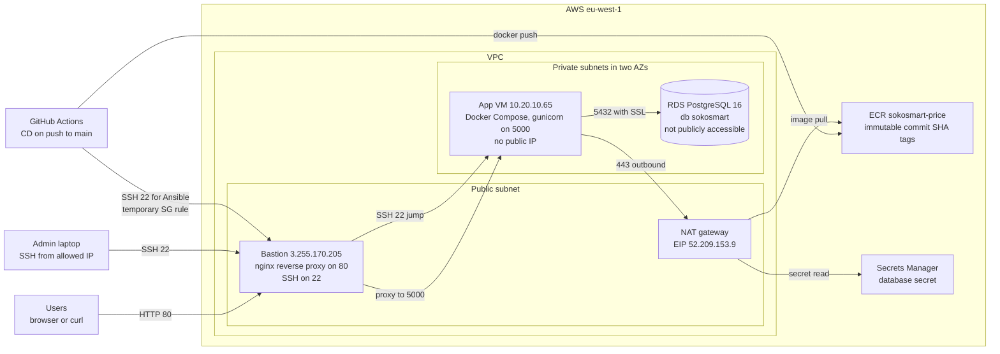

# SokoSmart

> Know the market price before you go to market.

SokoSmart is a crop market-price tracker for smallholder farmers and traders in East Africa. Farmers and market agents report prices, and anyone can compare the same crop across markets.

**Live URL:** http://3.255.170.205
**Health check:** http://3.255.170.205/health

The live stack is torn down with `terraform destroy` after grading to stop AWS charges. The demo video shows it running.

## What this repository delivers

A merge to `main` is tested, scanned, built, pushed to a private ECR repository and deployed to a VM in a private subnet through Ansible, then verified through `/health`.

| Area | Implementation |
|---|---|
| Application | Flask price service, gunicorn, Docker |
| Infrastructure | Terraform on AWS eu-west-1 (VPC, public and private subnets, NAT, bastion, private app VM, RDS PostgreSQL 16, security groups, ECR, IAM) |
| Configuration | Ansible roles for Docker, firewall, SSH hardening, the app (Docker Compose) and an nginx proxy on the bastion |
| CI | `ci.yml` (ruff, pytest, Docker build), `security.yml` (pip-audit, Trivy, Checkov), Gitleaks, ansible-lint |
| CD | `cd.yml` on push to `main` |
| Observability | `/health`, `/ready`, structured JSON logs, RDS CloudWatch log groups |

## Architecture



Traffic and trust boundaries:

| Layer | Rule |
|---|---|
| Bastion security group | HTTP 80 from the internet. SSH 22 from the admin IP, and from the CD runner only while a deploy runs |
| App security group | SSH 22 and TCP 5000 from the bastion security group only. Outbound 80 and 443 to the internet, and 5432 to the database group |
| Database security group | TCP 5432 from the app security group only. No CIDR rules |
| Egress | Private subnets reach ECR and Secrets Manager through the NAT gateway over the public AWS endpoints. There are no VPC endpoints, to save cost |

The app VM has no public IP. Users reach it only through nginx on the bastion. The app reads its database connection string from Secrets Manager at deploy time using its instance profile, so no credentials are stored in the repository.

## API

| Method | Endpoint | Purpose |
|---|---|---|
| GET | `/` | Web dashboard |
| GET | `/health` | Liveness check |
| GET | `/ready` | Readiness check, includes database status |
| GET | `/api/prices?crop=&market=` | List and filter prices |
| POST | `/api/prices` | Report a price (201 on success, 400 on invalid input) |
| GET | `/api/prices/summary` | Per-crop statistics |
| GET | `/api/crops/<crop>/compare` | Compare markets for a crop (404 for an unknown crop) |

```bash
curl http://3.255.170.205/health
curl http://3.255.170.205/ready
curl "http://3.255.170.205/api/prices?crop=maize"
curl http://3.255.170.205/api/prices/summary
```

## Run locally

Prerequisites: Git and Docker Desktop.

```powershell
git clone https://github.com/M-a-web179/SokoSmart-Group-7-.git
Set-Location SokoSmart-Group-7-
Copy-Item .env.example .env
docker compose up --build
```

Open http://localhost:5000. Stop with `docker compose down`.

Without Docker (Python 3.11):

```bash
cd services/price-service
python -m venv venv
pip install -r requirements-dev.txt
pytest -v
python run.py
```

## CI/CD

### CI

Pull requests to `main` and pushes to other branches run:

| Check | Tool |
|---|---|
| lint | `ruff check` |
| test | `pytest -v` |
| docker | image build without push |
| pip-audit | dependency vulnerabilities |
| trivy | image scan, fails on HIGH and CRITICAL (unfixed ignored) |
| checkov | Terraform scan, documented skip list in `security.yml` and `SECURITY.md` |
| ansible-lint | Ansible roles and playbooks |
| gitleaks | secret scanning |

`main` is protected. Every change needs one approving review and passing checks.

### CD

`.github/workflows/cd.yml` runs on every push to `main`:

1. lint, tests, pip-audit, Trivy and Checkov must all pass. Any failure blocks the deploy.
2. The image is built and tagged with the short commit SHA. The ECR repository has immutable tags, so `latest` is never used. If the tag already exists, the push is skipped.
3. The runner authenticates to AWS and logs in to ECR.
4. It opens port 22 on the bastion security group for the runner's IP only.
5. It generates the Ansible inventory and `terraform.generated.yml` from the repository variables with `inventory_from_terraform.py --image-tag <short SHA>`, then runs `site.yml`, which deploys the app and configures the nginx proxy on the bastion.
6. It polls `http://<bastion>/health` until it returns HTTP 200.
7. A final step always revokes the temporary SSH rule, even when the deploy fails.

Repository secrets: `AWS_ACCESS_KEY_ID`, `AWS_SECRET_ACCESS_KEY`, `SSH_PRIVATE_KEY`.
Repository variables: `BASTION_IP`, `APP_PRIVATE_IP`, `BASTION_SG_NAME`, `DB_SECRET_ARN`.

## Operations manual

### Provision the infrastructure

Prerequisites: Terraform 1.10 or newer, AWS CLI v2 with an IAM user that can manage EC2, VPC, RDS, ECR, IAM and S3, and an SSH key at `~/.ssh/sokosmart_f3`.

```powershell
Set-Location terraform
terraform init "-backend-config=backend.hcl"
terraform validate
terraform plan -out=tfplan
terraform apply tfplan
terraform output
```

`backend.hcl` and `terraform.tfvars` are local and gitignored. Remote state is in S3 with native locking. `ssh_allowed_cidrs` in `terraform.tfvars` holds the admin IP as a `/32`. If SSH times out, the admin IP has probably changed: update that value, plan and apply.

### Deploy manually with Ansible

Run from WSL Ubuntu on a copy of the repository outside `/mnt/c`, because Ansible ignores `ansible.cfg` on Windows mounts. Strip CRLF line endings in the copy.

```bash
cd ~/sokosmart-run
python3 ansible/inventory_from_terraform.py --key ~/.ssh/sokosmart_f3 --image-tag 8d1c511 --outputs outputs.json
echo '{}' > ansible/local.yml
cd ansible
ansible-galaxy collection install -r requirements.yml
ansible-playbook site.yml -e @terraform.generated.yml -e @local.yml
```

`--image-tag` is the short commit SHA of an image that already exists in ECR. The script refuses to overwrite existing generated files unless you add `--force`. `outputs.json` is the export of `terraform output -json`. `site.yml` also configures the nginx proxy, so there is no separate proxy command.

Run the whole `site.yml` without `--limit`, because the app play needs facts from the bastion. See `ansible/README.md` for the roles.

### Verify

```bash
curl -i http://3.255.170.205/health
curl -s http://3.255.170.205/ready
```

`/ready` reports `"database":"ok"` when the app can reach RDS.

### Observability

| Signal | Where |
|---|---|
| Liveness | `/health` returns 200 while the process runs |
| Readiness | `/ready` checks the database connection |
| Application logs | Structured JSON on stdout. On the app VM: `sudo docker compose -f /opt/sokosmart/docker-compose.yml logs app` |
| Database logs | CloudWatch log groups for the RDS instance |
| Deploy history | GitHub Actions run history for `CD` |

To reach the app VM, jump through the bastion:

```powershell
ssh -i $HOME\.ssh\sokosmart_f3 -o "ProxyCommand=ssh -i $HOME\.ssh\sokosmart_f3 -W %h:%p -o StrictHostKeyChecking=accept-new ubuntu@3.255.170.205" ubuntu@10.20.10.65
```

### Rollback

Images are immutable and tagged with commit SHAs. To roll back, run the manual Ansible deploy again with `--force` and `--image-tag` set to an earlier SHA that is still in ECR.

### Tear down

```powershell
Set-Location terraform
terraform destroy
```

Afterwards confirm in the AWS console that the NAT gateway, Elastic IPs, RDS instance and RDS CloudWatch log groups are gone. The state bucket from `terraform/bootstrap` is not removed by this command.

## Security

- No secrets in the repository. AWS keys and the SSH key live in GitHub Secrets. The database secret lives in Secrets Manager.
- The app VM and RDS are in private subnets. RDS accepts connections only from the app security group, over SSL.
- SSH accepts keys only, UFW restricts inbound traffic, and Docker ports are filtered by a DOCKER-USER policy.
- ECR tags are immutable.
- Scans run in CI and CD. The Checkov skip list and the single inline skip are documented in `SECURITY.md`.

## Known limitations

- The price repository is in memory. Prices posted through the API are not stored in PostgreSQL and are lost when the container restarts. RDS is used for the readiness check and is provisioned for the persistence work that follows.
- ECR and Secrets Manager are reached through the NAT gateway rather than VPC endpoints. Endpoints would be the production improvement.
- The CD workflow uses a long-lived IAM access key. OIDC federation with a role would be the production improvement.

## Team

| Member | Responsibility |
|---|---|
| Matthew Ainomugisha (M-a-web179) | ECR, RDS, security chain, IAM, root Terraform wiring, AWS apply, GitHub Secrets, architecture |
| Victor Idowu (Victor-VIO) | Network and bastion module, `/health`, `/ready`, structured logging |
| Dominion Yusuf (domyusuf) | Ansible roles and deployment |
| Hamzat Victor Oluwabori (HelloWorldVictor) | CD workflow review, scan thresholds, changelog |

See [CHANGELOG.md](CHANGELOG.md) for the history and [CONTRIBUTING.md](CONTRIBUTING.md) for the workflow.

## Video Presentation Link
https://youtu.be/vPZoZVCxVC4 

## License

MIT. See [LICENSE](LICENSE).
