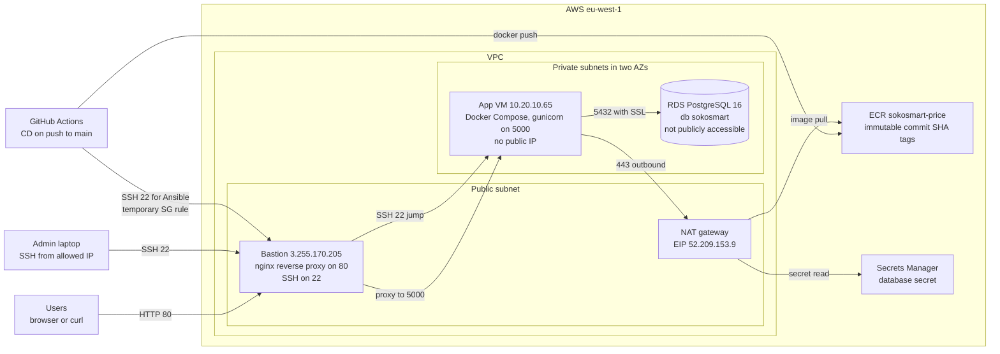

# Architecture diagram

## Network rules

| Layer | Rule |
|---|---|
| Bastion SG | HTTP 80 from the internet, SSH 22 from the admin IP and from the CD runner for the duration of a deploy |
| App SG | SSH 22 and TCP 5000 from the bastion SG only; outbound 80 and 443 to the internet and 5432 to the DB SG |
| DB SG | TCP 5432 from the app SG only, no CIDR rules |
| Egress path | Private subnets route through the NAT gateway to the public AWS endpoints (no VPC endpoints, to save cost) |